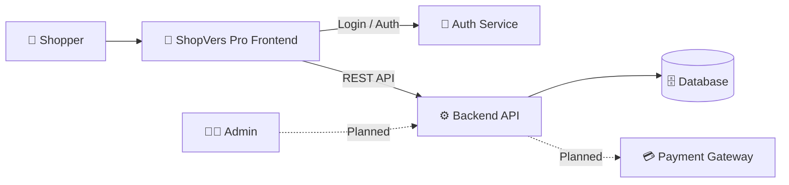

<div align="center">


<a href="https://https://shopvers.me/">
  
</a>

<br/><br/>

[](https://YOUR-LIVE-URL.com)
[](#-roadmap)
[](https://YOUR-LIVE-URL.com)
[](#-contributing)

<br/>

<a href="https://YOUR-LIVE-URL.com"><b>🌐 Live Demo</b></a>
&nbsp;•&nbsp;
<a href="#-features"><b>✨ Features</b></a>
&nbsp;•&nbsp;
<a href="#-getting-started"><b>🚀 Get Started</b></a>
&nbsp;•&nbsp;
<a href="#-roadmap"><b>🗺️ Roadmap</b></a>

</div>


## 📑 Table of Contents

- [🌟 About](#-about)
- [✨ Features](#-features)
- [📸 Screenshots](#-screenshots)
- [🛠️ Tech Stack](#️-tech-stack)
- [🏗️ Architecture](#️-architecture)
- [📂 Project Structure](#-project-structure)
- [🚀 Getting Started](#-getting-started)
- [🔐 Environment Variables](#-environment-variables)
- [🗺️ Roadmap](#️-roadmap)
- [🤝 Contributing](#-contributing)
- [👨‍💻 Author](#-author)


## 🌟 About

**ShopVers Pro** is a full-stack e-commerce web application built to give shoppers a fast, smooth, and secure buying experience, and to give store owners a solid foundation to sell online.

> 🌐 **Live website:** [https://YOUR-LIVE-URL.com](https://YOUR-LIVE-URL.com)

<div align="center">

| 🛒 **For Shoppers** | 🏪 **For Store Owners** | 👨‍💻 **For Developers** |
|:---:|:---:|:---:|
| Clean, responsive storefront | Powerful backend APIs | Clean, modular codebase |
| Secure account & login | Scalable architecture | Easy local setup |

</div>

> 🚧 **Project status:** ShopVers Pro is under active development. The backend is largely complete and the frontend currently covers authentication (login). More storefront pages are on the way. See the [Roadmap](#️-roadmap).

---

## ✨ Features

| | Feature | Status |
|:---:|---|:---:|
| 🔐 | **Secure authentication & login** | ✅ Live |
| ⚙️ | **REST API backend** (core endpoints) | ✅ Built |
| 🌐 | **Deployed & publicly accessible** | ✅ Live |
| 🛍️ | **Product catalog & details pages** | 🔜 Planned |
| 🔎 | **Search, filters & categories** | 🔜 Planned |
| 🛒 | **Shopping cart** | 🔜 Planned |
| 💳 | **Checkout & online payments** | 🔜 Planned |
| 📦 | **Order management & tracking** | 🔜 Planned |
| 🧑‍💼 | **Admin dashboard** | 🔜 Planned |
| ⭐ | **Reviews & ratings** | 🔜 Planned |

---

## 📸 Screenshots

<div align="center">

| 🔐 Login | 🏠 Home |
|:---:|:---:|
|  |  |

</div>

---

## 🛠️ Tech Stack

<div align="center">

<!-- EDIT the icon list after i= with your own technologies, e.g. react,nodejs,mongodb,tailwind,vercel -->


</div>

| Layer | Technologies |
|:---:|---|
| 🎨 **Frontend** | *(your frontend framework, styling, etc.)* |
| ⚙️ **Backend** | *(your backend framework, REST API)* |
| 🗄️ **Database** | *(your database)* |
| 🔐 **Auth** | *(JWT / sessions / provider)* |
| ☁️ **Deployment** | *(Vercel / Render / Railway / etc.)* |

---

## 🏗️ Architecture



---

## 📂 Project Structure

```text
YOUR-REPO-NAME/
├── backend/          # REST API, business logic, database layer
├── frontend/         # ShopVers Pro web UI
├── docs/
│   └── screenshots/  # README images
└── README.md
```

> Adjust the folder names to match your repository.

---

## 🚀 Getting Started

Want a quick look? 👉 **[Open the live app](https://YOUR-LIVE-URL.com)**. To run ShopVers Pro locally:

### Prerequisites

- **Node.js** 18+ (or Python 3.10+ if your backend uses Python)
- **Git**
- A database as used by the project

### 1️⃣ Clone the repository

```bash
git clone https://github.com/abuhuraira5130/YOUR-REPO-NAME.git
cd YOUR-REPO-NAME
```

### 2️⃣ Start the backend

```bash
cd backend
# Node backend:
npm install
npm run dev

# Python backend instead:
# python -m venv venv && source venv/bin/activate   (Windows: .\venv\Scripts\activate)
# pip install -r requirements.txt
# python manage.py runserver 8000
```

### 3️⃣ Start the frontend

```bash
cd frontend
npm install
npm run dev
```

Then open the local URL printed in your terminal.

---

## 🔐 Environment Variables

Create a `.env` file in `backend/` (and `frontend/` if needed). Example:

```env
PORT=8000
DATABASE_URL=your_database_connection_string
JWT_SECRET=your_secret_key
FRONTEND_URL=http://localhost:5173
```

> ⚠️ **Never commit `.env` files or secret keys to GitHub.** Edit the variable names to match your project.

---

## 🗺️ Roadmap

- [x] Backend REST API (core)
- [x] Frontend setup & authentication (login)
- [x] Live deployment
- [ ] Product catalog & product detail pages
- [ ] Search, filters & categories
- [ ] Shopping cart
- [ ] Checkout & payment integration
- [ ] Order history & tracking
- [ ] Admin dashboard
- [ ] Reviews & ratings
- [ ] Performance & SEO improvements

---

## 🤝 Contributing

Contributions, ideas, and feedback are welcome!

1. Fork the repository
2. Create a branch: `git checkout -b feature/amazing-feature`
3. Commit your changes: `git commit -m "Add amazing feature"`
4. Push: `git push origin feature/amazing-feature`
5. Open a Pull Request

---

## 👨‍💻 Author

<div align="center">

### **Abu Huraira**
*BSAI Student · Full-Stack & AI Developer*

[](https://github.com/abuhuraira5130)
[](https://YOUR-LIVE-URL.com)

<br/>

⭐ **If you like ShopVers Pro, give it a star!** ⭐


</div>
