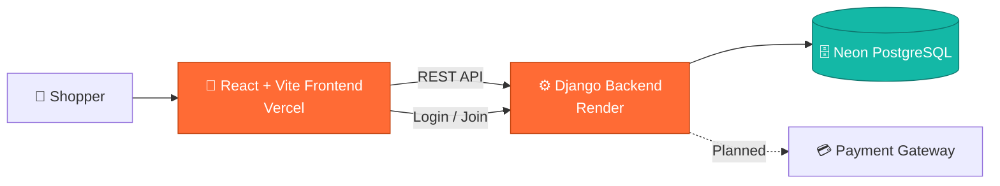

<div align="center">


<a href="https://shopvers.me">
  
</a>

<br/><br/>

[](https://shopvers.me)
[](#-roadmap)
[](#-contributing)


<br/>

<a href="https://shopvers.me"><b>🌐 Live Site</b></a>
&nbsp;•&nbsp;
<a href="#-features"><b>✨ Features</b></a>
&nbsp;•&nbsp;
<a href="#-getting-started"><b>🚀 Get Started</b></a>
&nbsp;•&nbsp;
<a href="#-roadmap"><b>🗺️ Roadmap</b></a>

</div>


## 📑 Table of Contents

- [🌟 About](#-about)
- [✨ Features](#-features)
- [📸 Screenshots](#-screenshots)
- [🛠️ Tech Stack](#️-tech-stack)
- [🏗️ Architecture](#️-architecture)
- [📂 Project Structure](#-project-structure)
- [🚀 Getting Started](#-getting-started)
- [🔐 Environment Variables](#-environment-variables)
- [☁️ Deployment](#️-deployment)
- [🗺️ Roadmap](#️-roadmap)
- [🤝 Contributing](#-contributing)
- [👨‍💻 Author](#-author)


## 🌟 About

**ShopVers Pro** is a full-stack e-commerce web application with a premium, responsive storefront powered by a **Django REST API**. It is designed to give shoppers a fast, clean, and secure experience, and to give store owners a solid foundation to sell online.

> 🌐 **Live website:** [https://shopvers.me](https://shopvers.me)

<div align="center">

| 🛒 **For Shoppers** | 🏪 **For Store Owners** | 👨‍💻 **For Developers** |
|:---:|:---:|:---:|
| Clean, responsive storefront | Backend-driven product data | Modular React + Django codebase |
| Product search & pagination | Scalable API architecture | One-command local setup |
| Secure account & login | Cloud-ready deployment | Vercel + Render ready |

</div>

> 🚧 **Project status:** ShopVers Pro is under active development. The backend is largely complete and the frontend covers the storefront home, product search and pagination, and authentication. See the [Roadmap](#️-roadmap) for what's next.

---

## ✨ Features

| | Feature | Status |
|:---:|---|:---:|
| 🎨 | **Premium responsive UI** with modern gradients and clean interactions | ✅ Live |
| 🔎 | **Product search** by title or description | ✅ Live |
| 📄 | **Pagination** for product listings | ✅ Live |
| 🔐 | **Authentication** (Login / Join Now) | ✅ Live |
| ⚙️ | **Django REST API** powering product data | ✅ Built |
| ☁️ | **Cloud deployment** (Vercel + Render + Neon PostgreSQL) | ✅ Live |
| 🛒 | **Shopping cart** | 🚧 In progress |
| 💳 | **Checkout & online payments** | 🔜 Planned |
| 📦 | **Orders & order tracking** | 🔜 Planned |
| 🧑‍💼 | **Admin dashboard** | 🔜 Planned |
| ⭐ | **Reviews & ratings** | 🔜 Planned |

---

## 📸 Screenshots

<div align="center">

| 🏠 Home | 🔐 Login |
|:---:|:---:|
|  |  |

</div>

---

## 🛠️ Tech Stack

<div align="center">


</div>

| Layer | Technologies |
|:---:|---|
| 🎨 **Frontend** | React, Vite, JavaScript (JSX), CSS |
| ⚙️ **Backend** | Python, Django (REST API) |
| 🗄️ **Database** | PostgreSQL (Neon) |
| ☁️ **Hosting** | Vercel (frontend), Render (backend) |
| 🌐 **Domain** | [shopvers.me](https://shopvers.me) |

---

## 🏗️ Architecture



---

## 📂 Project Structure

```text
ecommerce-fullstack-design/
├── Backend/                  # Django REST API
├── Frontend/                 # React + Vite storefront
│   ├── src/
│   │   ├── components/       # Reusable UI components
│   │   ├── hooks/            # Custom React hooks
│   │   ├── layouts/          # Page layouts
│   │   ├── pages/            # Route pages
│   │   ├── services/         # API calls to the backend
│   │   ├── styles/           # Stylesheets
│   │   ├── App.jsx
│   │   └── main.jsx
│   ├── index.html
│   ├── package.json
│   ├── vite.config.js
│   └── vercel.json           # Vercel deployment config
├── render.yaml               # Render deployment config (backend)
├── production ready plan.md
└── README.md
```

---

## 🚀 Getting Started

Want a quick look? 👉 **[Open the live site](https://shopvers.me)**. To run ShopVers Pro locally:

### Prerequisites

- **Node.js** 18+
- **Python** 3.10+
- **Git**
- A PostgreSQL database (a free [Neon](https://neon.tech) database works well)

### 1️⃣ Clone the repository

```bash
git clone https://github.com/abuhuraira5130/ecommerce-fullstack-design.git
cd ecommerce-fullstack-design
```

### 2️⃣ Start the backend (Django)

```bash
cd Backend

# Create and activate a virtual environment
python -m venv venv
.\venv\Scripts\activate      # Windows
source venv/bin/activate     # Mac / Linux

# Install dependencies
pip install -r requirements.txt

# Apply database migrations and run the server
python manage.py migrate
python manage.py runserver 8000
```

### 3️⃣ Start the frontend (React + Vite)

```bash
cd Frontend
npm install
npm run dev
```

Open the local URL printed in your terminal.

---

## 🔐 Environment Variables

Example values. Adjust the names to match your project.

**Backend: `Backend/.env`**

```env
SECRET_KEY=your_django_secret_key
DEBUG=True
DATABASE_URL=your_neon_postgresql_connection_string
ALLOWED_HOSTS=localhost,127.0.0.1
CORS_ALLOWED_ORIGINS=http://localhost:5173
```

**Frontend: `Frontend/.env`**

```env
VITE_API_URL=http://localhost:8000
```

> ⚠️ **Never commit `.env` files or secret keys to GitHub.**

---

## ☁️ Deployment

| Part | Platform | Config |
|---|---|---|
| 🎨 **Frontend** | Vercel | `Frontend/vercel.json` |
| ⚙️ **Backend** | Render | `render.yaml` |
| 🗄️ **Database** | Neon PostgreSQL | Connection via `DATABASE_URL` |
| 🌐 **Domain** | shopvers.me | Custom domain |

For production, set `DEBUG=False`, add `https://shopvers.me` to `CORS_ALLOWED_ORIGINS`, and point the frontend API URL to your deployed backend.

---

## 🗺️ Roadmap

- [x] Django REST API (core)
- [x] React + Vite storefront
- [x] Product search & pagination
- [x] Authentication (login)
- [x] Live deployment on [shopvers.me](https://shopvers.me)
- [ ] Shopping cart (in progress)
- [ ] Product detail pages
- [ ] Checkout & payment integration
- [ ] Orders & order tracking
- [ ] Admin dashboard
- [ ] Reviews & ratings
- [ ] Performance & SEO improvements

---

## 🤝 Contributing

Contributions, ideas, and feedback are welcome!

1. Fork the repository
2. Create a branch: `git checkout -b feature/amazing-feature`
3. Commit your changes: `git commit -m "Add amazing feature"`
4. Push: `git push origin feature/amazing-feature`
5. Open a Pull Request

---

## 👨‍💻 Author

<div align="center">

### **Abu Huraira**
*BSAI Student · Full-Stack & AI Developer*

[](https://github.com/abuhuraira5130)
[](https://shopvers.me)

<br/>

⭐ **If you like ShopVers Pro, give it a star!** ⭐


</div>
