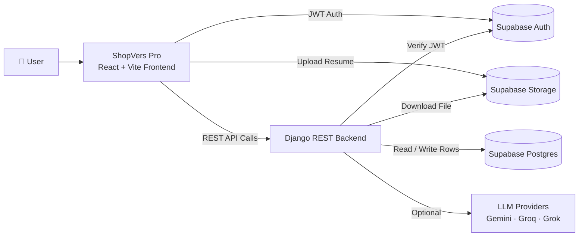

<div align="center">


<a href="https://YOUR-LIVE-URL.com">
  
</a>

<br/>

[](https://YOUR-LIVE-URL.com)
[](https://YOUR-LIVE-URL.com)
[](#-author)


### 🚀 [**Try ShopVers Pro Live →**](https://YOUR-LIVE-URL.com)

</div>

---

## 📑 Table of Contents

- [🌟 About ShopVers Pro](#-about-shopvers-pro)
- [✨ Key Features](#-key-features)
- [📸 Screenshots](#-screenshots)
- [🛠️ Tech Stack](#️-tech-stack)
- [🏗️ System Architecture](#️-system-architecture)
- [📂 Project Structure](#-project-structure)
- [🔄 How It Works](#-how-it-works)
- [📡 API Reference](#-api-reference)
- [🚀 Getting Started](#-getting-started)
- [🔐 Environment Variables](#-environment-variables)
- [🗄️ Database Schema](#️-database-schema)
- [🧠 AI Provider Configuration](#-ai-provider-configuration)
- [🩺 Troubleshooting](#-troubleshooting)
- [🌍 Deployment](#-deployment)
- [👨‍💻 Author](#-author)

---

## 🌟 About ShopVers Pro

**ShopVers Pro** is an enterprise-grade, full-stack platform that processes, scores, and improves professional resumes using **deterministic algorithms** combined with **Large Language Models (LLMs)**.

> 🌐 **Live website:** [https://YOUR-LIVE-URL.com](https://YOUR-LIVE-URL.com)

Upload a resume, pick a target job, and ShopVers Pro gives you:

| | |
|---|---|
| 📊 **Job-targeted analysis** | Scores, skill gaps, quick wins, salary range, and cover letter drafts |
| 🎤 **Mock interviews** | Questions generated from your own resume and skills |
| 🧠 **Smart evaluation** | Answer scoring with strengths and improvement tips |
| 📋 **Job tracker** | A Kanban board for your whole application journey |

---

## ✨ Key Features

| Feature | What ShopVers Pro does |
|---|---|
| 📄 **Precision Document Parsing** | Extracts structured data from PDF and DOCX files with high fidelity. |
| 🎯 **Deterministic ATS Scoring** | Math-based rubric for compatibility, keyword density, and gap analysis. No AI hallucinations. |
| 🤖 **AI-Powered Optimization** | Gemini, Groq, and Grok rewrite bullet points and strengthen action verbs. |
| 📤 **Multi-Format Export** | Exports optimized resumes as production-ready PDF and DOCX files. |
| 📋 **Kanban Job Tracker** | Wishlist → Applied → Interviewing → Offered. |
| 🎙️ **Mock AI Interviewer** | Technical, behavioral, and system design questions tailored to you. |
| ✉️ **Cover Letter Drafts** | Professional, conversational, and creative tones. |
| 🔐 **Secure by Design** | Supabase Auth (JWT), Row Level Security, and private file storage. |

---

## 📸 Screenshots

<div align="center">

| 🏠 Dashboard | 📊 Resume Analysis |
|:---:|:---:|
|  |  |

| 📋 Job Tracker | 🎤 Mock Interview |
|:---:|:---:|
|  |  |

</div>

---

## 🛠️ Tech Stack

<div align="center">

| Layer | Technologies |
|:---:|---|
| 🎨 **Frontend** | React 18, Vite, TanStack Router, Tailwind CSS, Framer Motion, Lucide Icons, Zod |
| ⚙️ **Backend** | Django, Django REST Framework, pypdf, python-docx, scikit-learn |
| 🤖 **AI** | Google Gemini, Groq, xAI Grok |
| 🗄️ **Data** | Supabase (PostgreSQL, Auth, Storage, Row Level Security) |

</div>

---

## 🏗️ System Architecture



---

## 📂 Project Structure

```text
careerforge-ai/
├── backend/                     # Django REST API + scoring logic
│   ├── api/
│   │   ├── views.py             # API endpoints
│   │   ├── urls.py              # Route mapping
│   │   └── services.py          # Parsing, scoring & interview logic
│   ├── config/                  # Django settings, wsgi/asgi
│   ├── scripts/
│   │   └── test_api.py          # Quick local integration test
│   ├── manage.py
│   └── requirements.txt
│
├── frontend/                    # ShopVers Pro web UI
│   └── src/
│       ├── serverFns/           # Server functions calling backend endpoints
│       └── lib/
│           └── backend.ts       # fetch wrapper: backendPost()
│
├── docs/
│   └── screenshots/             # README images
├── Resume_Analyzer_Proposal_short.md
└── README.md
```

---

## 🔄 How It Works

<details open>
<summary><b>1️⃣ Authentication</b></summary>
<br/>

The frontend gets a user JWT from **Supabase Auth**. Every backend call includes `accessToken`, and the backend verifies it against Supabase `/auth/v1/user` before touching any data.

</details>

<details open>
<summary><b>2️⃣ Resume Upload</b></summary>
<br/>

The resume is uploaded to **Supabase Storage**, and a row is created in the `resumes` table with a `file_path` pointing to the stored file.

</details>

<details open>
<summary><b>3️⃣ Resume Parsing — <code>POST /api/resumes/parse/</code></b></summary>
<br/>

The backend downloads the file and extracts text (PDF via `pypdf`, DOCX via `python-docx`, otherwise UTF-8 fallback). It then computes:

- `extracted_skills`: regex match against a large `COMMON_SKILLS` list
- `total_experience_years`: from "X years" patterns or graduation years
- `education_level`: PhD, Master's, Bachelor's, etc.
- `word_count` and `is_ats_friendly`: contact info, section keywords, and reasonable length

</details>

<details open>
<summary><b>4️⃣ Job-Targeted Analysis — <code>POST /api/analyses/create/</code></b></summary>
<br/>

Generates ATS, skills, experience, education, and culture-fit scores, plus interview probability, letter grade, matched and missing keywords, skill gaps, a learning roadmap, quick wins, a salary range, and cover letter drafts.

</details>

<details open>
<summary><b>5️⃣ Mock Interview — start → evaluate → finish</b></summary>
<br/>

- **Start:** builds N questions (technical / behavioral / system design) from your skills
- **Evaluate:** scores each answer on relevance, completeness, communication, and depth using TF-IDF cosine similarity and STAR-style structure heuristics
- **Finish:** returns an overall score, grade, performance breakdown, strengths, and improvements

</details>

---

## 📡 API Reference

**Base path:** `/api/` · All endpoints accept **JSON** bodies.

| Method | Endpoint | Description |
|:---:|---|---|
| `GET` | `/api/health/` | Health check |
| `POST` | `/api/resumes/parse/` | Parse an uploaded resume |
| `POST` | `/api/resumes/delete/` | Delete a resume |
| `POST` | `/api/resumes/set-primary/` | Set the primary resume |
| `POST` | `/api/analyses/create/` | Create a job-targeted analysis |
| `POST` | `/api/analyses/delete/` | Delete an analysis |
| `POST` | `/api/interview/start/` | Start an interview session |
| `POST` | `/api/interview/evaluate/` | Evaluate a single answer |
| `POST` | `/api/interview/finish/` | Finish and summarize the interview |
| `POST` | `/api/interview/delete/` | Delete an interview session |

<details>
<summary><b>📥 Example request bodies (click to expand)</b></summary>

#### Parse Resume
```json
{
  "accessToken": "<user_jwt>",
  "resumeId": "<uuid>"
}
```

#### Create Analysis
```json
{
  "accessToken": "<user_jwt>",
  "resumeId": "<uuid>",
  "jobTitle": "...",
  "companyName": "...",
  "location": "...",
  "companyDescription": "...",
  "jobDescription": "..."
}
```

#### Start Interview
```json
{
  "accessToken": "<user_jwt>",
  "resumeId": "<uuid>",
  "difficulty": "medium",
  "mode": "text",
  "totalQuestions": 10
}
```

#### Evaluate Answer
```json
{
  "accessToken": "<user_jwt>",
  "sessionId": "<uuid>",
  "questionId": 1,
  "questionText": "...",
  "questionCategory": "technical",
  "questionDifficulty": "medium",
  "userAnswer": "...",
  "language": "en"
}
```

#### Finish Interview
```json
{
  "accessToken": "<user_jwt>",
  "sessionId": "<uuid>"
}
```

</details>

---

## 🚀 Getting Started

Want to see it first? 👉 **[Open the live app](https://YOUR-LIVE-URL.com)**. To run ShopVers Pro locally:

### Prerequisites

- **Node.js** 18+ (or Bun)
- **Python** 3.10+
- A **Supabase project** (Auth + Postgres + Storage)

### 1️⃣ Clone the repository

```bash
git clone https://github.com/abuhuraira5130/careerforge-ai.git
cd careerforge-ai
```

### 2️⃣ Run the backend (Django)

```bash
cd backend

# Create and activate a virtual environment
python -m venv venv
.\venv\Scripts\activate      # Windows
source venv/bin/activate     # Mac / Linux

# Install dependencies
pip install -r requirements.txt

# Start the server
python manage.py runserver 8000
```

### 3️⃣ Run the frontend (React + Vite)

```bash
cd frontend
npm install
npm run dev
```

Open the local URL printed in your terminal (for example `http://localhost:8080` or `http://localhost:5173`).

---

## 🔐 Environment Variables

### Frontend — `frontend/.env`

| Variable | Description |
|---|---|
| `VITE_BACKEND_URL` | Backend URL (e.g. `http://localhost:8000`) |
| `VITE_SUPABASE_URL` | Your Supabase project URL |
| `VITE_SUPABASE_ANON_KEY` | Supabase anon public key |

### Backend — `backend/.env`

| Variable | Required | Description |
|---|:---:|---|
| `DATABASE_URL` | ✅ | Supabase Postgres connection string (include `sslmode=require`) |
| `SUPABASE_URL` | ✅ | Supabase project URL |
| `SUPABASE_ANON_KEY` | ✅ | Supabase anon key |
| `SUPABASE_SERVICE_ROLE_KEY` | ✅ | Supabase service role key (**keep secret**) |
| `CORS_ALLOWED_ORIGINS` | ➖ | Comma-separated allowed origins |

> ⚠️ **Never commit `.env` files or your service role key to GitHub.**

---

## 🗄️ Database Schema

<details>
<summary><b>📁 resumes</b></summary>

`id`, `user_id`, `title`, `file_path`, `parse_status`, `parse_error`, `raw_text`, `extracted_skills`, `total_experience_years`, `education_level`, `word_count`, `is_ats_friendly`, `is_primary`

</details>

<details>
<summary><b>📁 analyses</b></summary>

`id`, `user_id`, `resume_id`, `status`, `error_message`, `job_title`, `company_name`, `location`, `job_description`, `company_description`, plus all scoring output fields from `generate_analysis`

</details>

<details>
<summary><b>📁 interview_sessions</b></summary>

`id`, `user_id`, `resume_id`, `difficulty`, `mode`, `language`, `status`, `total_questions`, `questions`, `answers`, `overall_score`, `grade`, `performance_breakdown`, `scores`, `strengths`, `improvements`

</details>

---

## 🧠 AI Provider Configuration

ShopVers Pro is modular. Users can add their own API keys from the **Profile Settings** page.

| Provider | Example Models |
|---|---|
| 🟣 **Google Gemini** | `gemini-1.5-flash`, `gemini-2.5-flash` |
| 🟠 **Groq** | `llama3-70b-8192`, `mixtral-8x7b-32768` |
| ⚫ **xAI Grok** | Grok models |

> 💡 Default fallbacks exist for quick onboarding, but per-user API keys are recommended for production.

---

## 🩺 Troubleshooting

<details>
<summary><b>Backend fails with a <code>DATABASE_URL</code> error</b></summary>

`config/settings.py` requires `DATABASE_URL`. Use your Supabase Postgres connection string and make sure it includes `sslmode=require`.

</details>

<details>
<summary><b>CORS errors in the browser</b></summary>

Add your frontend origin (e.g. `http://localhost:5173` or `http://localhost:8080`) to `CORS_ALLOWED_ORIGINS` in `backend/.env`.

</details>

<details>
<summary><b>"Resume isn't parsed yet"</b></summary>

Call order matters: `parse` → `analyses/create` → `interview/start`.

</details>

<details>
<summary><b>Storage permission failures</b></summary>

Make sure the Supabase Storage bucket allows authenticated users to access their own files, and that `resumes.file_path` values are correct.

</details>

---

## 🌍 Deployment

| Part | Platform |
|---|---|
| 🎨 **Frontend** | Vercel / Netlify (Vite build) |
| ⚙️ **Backend** | Render / Railway / Docker |
| 🗄️ **Database, Auth & Storage** | Supabase |

🌐 **Production URL:** [https://YOUR-LIVE-URL.com](https://YOUR-LIVE-URL.com)

Before deploying, set all environment variables and review your Supabase **Row Level Security** policies.

---

## 👨‍💻 Author

<div align="center">

### **Abu Huraira**
*BSAI Student · Full-Stack & AI Developer*

[](https://github.com/abuhuraira5130)
[](https://YOUR-LIVE-URL.com)

<br/>

⭐ **If you like ShopVers Pro, give it a star!** ⭐


</div>
